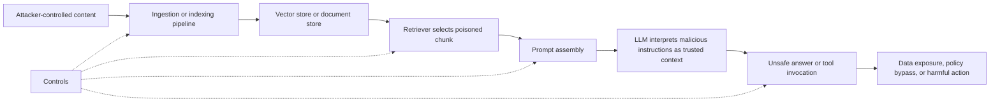

# Awesome LLM Security: Incidents, Prompt Injection, RAG, Agents, and AI Supply Chain Risks

A curated list of LLM security incidents, prompt injection research, RAG attack patterns, agent security failures, supply chain vulnerabilities, and defensive guides for production AI systems.

This repository is designed for security engineers, red teamers, AI platform teams, researchers, and builders who need practical references on large language model security, AI application threats, retrieval-augmented generation security, and agentic system abuse.

## Intro

Large language model security is broader than model alignment or jailbreaks. Real-world AI risk shows up across prompts, retrieval pipelines, vector databases, agent tools, gateways, SDKs, plugins, logs, and surrounding infrastructure.

This repo focuses on:

- LLM security incidents and notable disclosures from 2023 through 2026
- Prompt injection, indirect injection, and system prompt leakage patterns
- RAG security issues including retrieval poisoning, document injection, and data exposure
- Agent security risks such as unsafe tool use, memory poisoning, and approval bypass
- AI supply chain issues in proxies, wrappers, orchestration layers, and self-hosted platforms
- CVE references for AI-adjacent tools, serving stacks, and LLM application infrastructure

## Why This Repository Exists

Teams searching for `LLM security incidents`, `prompt injection examples`, `RAG attack flow`, `AI agent vulnerabilities`, or `LLM CVEs` usually find fragmented blog posts. This repository puts those topics into one navigable structure with timelines, categories, case studies, diagrams, and practitioner guides.

## Timeline

A total of 50 incident, disclosure, and attack-research entries are organized by year.

- [2023 timeline](timeline/2023.md)
- [2024 timeline](timeline/2024.md)
- [2025 timeline](timeline/2025.md)
- [2026 timeline](timeline/2026.md)

## Categories

- [Prompt security](categories/prompt.md)
- [RAG security](categories/rag.md)
- [Agent security](categories/agents.md)
- [Supply chain security](categories/supply-chain.md)

## Highlights

- [LiteLLM attack](case-studies/litellm-attack.md)
- [Claude command bypass](case-studies/claude-command-bypass.md)
- [RoguePilot](case-studies/roguepilot.md)
- [Whisper leak](case-studies/whisper-leak.md)
- [Mercor breach linked to LiteLLM](case-studies/mercor-litellm-breach.md)
- [LLM threat model guide](guides/llm-threat-model.md)
- [Secure architecture guide](guides/secure-architecture.md)
- [RAG attack flow diagram](diagrams/rag-attack-flow.md)
- [AI and LLM CVE references](references/cves.md)

## RAG Attack Flow



For the full breakdown, see [RAG attack flow diagram](diagrams/rag-attack-flow.md).

## Repository Layout

```text
.
├── README.md
├── categories
│   ├── agents.md
│   ├── prompt.md
│   ├── rag.md
│   └── supply-chain.md
├── case-studies
│   ├── claude-command-bypass.md
│   ├── litellm-attack.md
│   ├── mercor-litellm-breach.md
│   ├── roguepilot.md
│   └── whisper-leak.md
├── diagrams
│   └── rag-attack-flow.md
├── guides
│   ├── llm-threat-model.md
│   └── secure-architecture.md
├── references
│   └── cves.md
└── timeline
    ├── 2023.md
    ├── 2024.md
    ├── 2025.md
    └── 2026.md
```

## How To Use This Repo

- Start with the [timeline](timeline/2023.md) files if you want historical examples and notable disclosures.
- Use the [category](categories/prompt.md) pages if you want recurring attack patterns and control ideas.
- Use the [case studies](case-studies/litellm-attack.md) for deeper write-ups of representative failures.
- Use the [guides](guides/llm-threat-model.md) for threat modeling and secure LLM architecture reviews.
- Use the [CVE reference index](references/cves.md) when reviewing self-hosted or AI-adjacent components.

## Search Topics

Common topics covered here include:

- LLM security incidents
- AI security case studies
- Prompt injection examples
- RAG security checklist
- RAG attack flow
- AI agent security risks
- LLM CVEs
- Open WebUI vulnerabilities
- Ollama vulnerabilities
- LangChain vulnerabilities
- vLLM vulnerabilities
- Langflow vulnerabilities

## Conventions

- Timeline entries are concise and use a consistent format.
- Some entries are public incidents, some are CVE disclosures, and some are notable attack research.
- `CVE: None public` means no public CVE is known or the item is not primarily a CVE-tracked issue.
- The repository is a practical starting point, not a claim of exhaustive coverage.
