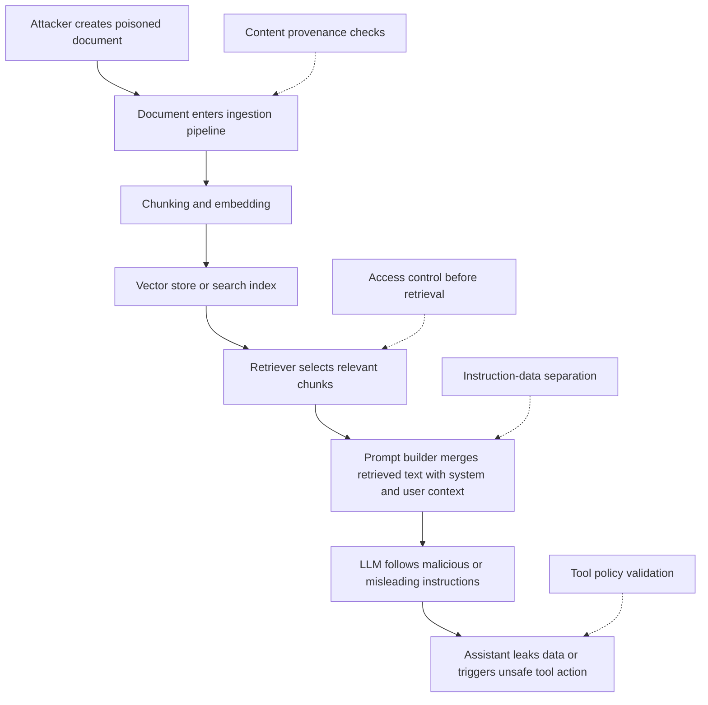

# RAG Attack Flow Diagram

This diagram shows a common retrieval-augmented generation attack path where attacker-controlled content is indexed, retrieved, and then interpreted as trusted instructions.

## Mermaid Diagram

## Attack Stages

1. An attacker places malicious instructions in content that looks like normal documentation, notes, tickets, or webpages.
2. The ingestion pipeline indexes that content without filtering for instruction-like payloads.
3. A later user query retrieves the poisoned chunk because it is semantically relevant.
4. The prompt builder places the chunk next to trusted instructions.
5. The model treats the malicious text as something it should follow.
6. The application returns a manipulated answer or passes unsafe data into a tool layer.

## Defensive Choke Points

- Secure the write path into the corpus.
- Apply authorization before retrieval.
- Track provenance for every chunk.
- Detect and downgrade instruction-like content.
- Keep retrieved data separate from privileged instructions.
- Validate every tool invocation outside the model.
